# Constellation

A night sky behind the conversation in the Claude desktop app, drawn from the work done in your project. Every file Claude edits becomes a star, and nearby files edited in the same turn join into a constellation, so the sky fills in over days.



## Install

```bash
claude plugin marketplace add Samarth2001/claude-plugins
claude plugin install constellation@samarth
```

Then run `/reload-plugins` in an open session, or start a new one.

## How the sky is drawn

| What Claude does | What appears |
| --- | --- |
| Edits a file (Edit, Write, NotebookEdit) | A star for that file, placed by its folder: files of one folder gather into a cluster |
| Edits it again | The star grows larger and brighter with each doubling of its edits. A file edited once is a small crisp point; from nine edits a star wears thin diffraction spikes, and from 24 a second, shorter set |
| Only reads a file | A faint dust star |
| Edits two or more files in one turn | Fine lines join the nearby ones into a constellation, up to the nine most-edited files of that turn. Files far apart form separate figures, and a lone far file stays unlinked |
| Runs a test suite that passes | A meteor crosses the sky at the end of that turn |

Star colors follow the file type, the way a star's color follows its spectral class:

| Files | Star |
| --- | --- |
| Rust, Go, C and C++, Zig, Swift, Kotlin, Java, C# | Blue |
| TypeScript and JavaScript | Blue-white |
| HTML, CSS, SVG, Vue, Svelte, Astro | Cyan |
| Markdown and plain text | White |
| Python, Ruby, PHP, shell, Lua, Perl, R, Julia | Pale gold |
| JSON, YAML, TOML, lock files, XML, CSV | Amber |
| Anything else | Rose |

Figures never cross one another, and no star meets more than three lines. Of the five newest constellations, each whose largest figure has three stars or more is named under that figure, after the folder most of its files sit in (the project's name for files at its root). The six brightest stars with three edits or more carry their file names. Labels stay faint, and one that would cover a star or another label is left out. Stars not edited for 30 days dim a little.

The sky changes only when a turn ends. Then new stars ignite one after another, new lines draw themselves between them and everything comes to rest; only the newest constellation keeps a slow breath. During a turn nothing moves but a slow twinkle in the background. Work done by subagents lands at the end of the turn that started them. The background stars and the galactic band are the same in every project; the stars over them are your project's own.

## Commands

| Command | Does |
| --- | --- |
| `/constellation` | Prints a summary: how many stars and constellations, the brightest files and the newest constellation |
| `/constellation off` | Turns the sky off here and in the sessions you start later. Your sky is kept and keeps recording |
| `/constellation on` | Brings the sky back |
| `/constellation reset` | Clears this project's sky |

## What it needs

- Claude Code v2.1.324 or later, in the desktop app's Code tab or the mobile app.
- A dark window. The scene and the colors it gives the app are dark, so set the app's appearance to dark.
- In the terminal and VS Code it draws nothing, but it still records your sky and `/constellation` still answers.

## What it stores and reads

- It stores only project-relative file paths with their edit and read counts and times, one sky per project, in the plugin's own store on your machine. A project holds at most 400 stars and 48 constellations: past that, the faintest stars and the oldest constellations go first.
- It reads the name of each tool call, the file path an edit or read names, and whether a Bash or PowerShell command looks like a test run. Files in `node_modules`, `.git`, `dist`, `build`, `.next`, `target`, `.venv` and `__pycache__` are left out.
- It never reads file contents, your prompts or Claude's replies, and it sends nothing anywhere.
- `/constellation reset` deletes the current project's sky.

## Known limits

- A session has one theme. Another theme mod replaces this one, and setting this one replaces the other.
- `/constellation off` clears whichever theme stands, not only this one.
- With reduced motion turned on in your system, the sky shows finished, with no ignition, line drawing, twinkle or meteor.
- Parts of the sky lie under the chat and the side panels by design. Clusters are scattered across the whole window, leaning to the sides, and the panels frost what is under them.

## Develop

From the repository root:

```bash
claude plugin validate plugins/constellation
claude plugin test plugins/constellation
claude --plugin-dir plugins/constellation     # try it, hot-reloads on save
```

`hooks/sky.ts` holds the data and the arithmetic (paths, merging a turn, the layout, the spanning tree, the summary), `hooks/scene.ts` builds the SVG scene, `hooks/look.ts` the app's colors and glass, and `hooks/register.tsx` the events, commands and theme.

The preview above is the scene exactly as the plugin draws it, over a sample project's sky. After changing the scene, draw it again:

```bash
node --experimental-strip-types scripts/assets/constellation-preview.mts
```

See [CHANGELOG.md](CHANGELOG.md) for releases.
