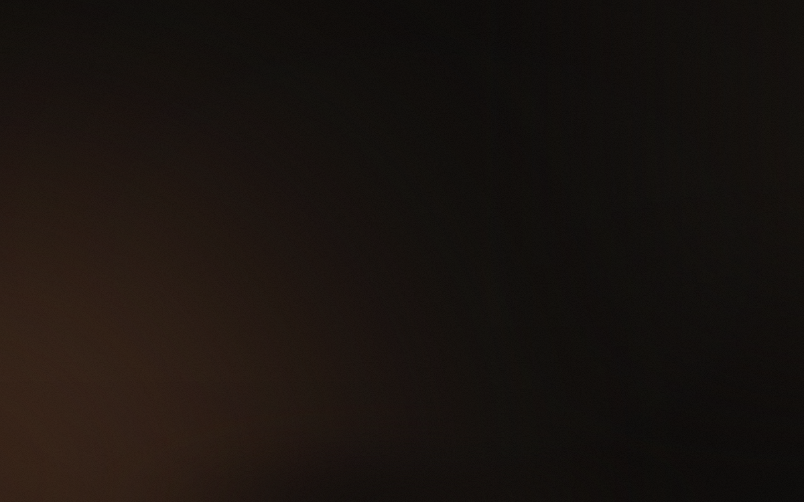

# Light Leak

A dark film frame behind the conversation in the Claude desktop app, with warm light seeping in at the lower left corner, the way light reaches the end of a roll of film, and a fainter warm wash down the right edge. The grain is fine and still, and nothing flickers. The light answers Claude's work slowly: it breathes in a little brighter while Claude works, turns rose after a failed tool call and washes in from the right when a turn ends. The app's own colours come from the same frame: brown-black grays and a soft amber.



## Install

```bash
claude plugin marketplace add Samarth2001/claude-plugins
claude plugin install light-leak@samarth
```

Then run `/reload-plugins` in an open session, or start a new one.

## How it moves

| What happens | The backdrop |
| --- | --- |
| Claude is working | The light breathes in a little brighter |
| A tool call | A slight warmth swells and fades |
| A tool call fails | The light turns rose for a moment |
| A turn ends | A soft warm wash from the right edge |
| The prompt box | Warmth pools under it, more as it grows |
| You send a message | A low glow rises from the bottom edge (a message you type: a continuation sends none) |
| The pointer | Light gathers faintly toward it |
| The hour (your computer's clock) | Amber by day, rose-amber at dawn and dusk, deeper at night |

Only the main conversation moves it: subagents' turns and tool calls change nothing.

## Use it

| Command | Does |
| --- | --- |
| `/light-leak` | Says whether it is on and drawn behind this window, and the glass |
| `/light-leak on` | Brings it back, and keeps it on |
| `/light-leak off` | Turns it off, here and in later sessions |
| `/light-leak glass clear\|soft\|frosted` | How much veil sits over the light behind the chat: none, a light one (the default), or the full frost. Kept across sessions |
| `/light-leak forget` | Deletes its settings and turns it off for this session. Run it before removing the plugin |

One theme shows at a time. Installed beside another theme and never turned on by name, Light Leak leaves the other one showing; `/light-leak on` puts it in place and keeps that choice for later sessions. `off` and `forget` clear the session's theme only while it is Light Leak's, so they never take another theme down.

The [`themes`](../themes) picker (`/themes`) shows it beside the other themes, with a Glass option.

## Where it shows

- The desktop app draws it live on Claude Code 2.1.326 or later.
- The mobile app, Reduce Motion and earlier builds show the still picture above, at night with its deeper, rosier base.
- The terminal and editors draw no backdrop.
- The shader runs at 30 fps and eases to a reduced sharpness on a weak GPU. `claude plugin validate` reports `sharpness 1.28 weak, 2.00 fast, at 30 fps`.

## Develop

From the repository root:

```bash
claude plugin validate --strict plugins/light-leak
claude plugin test plugins/light-leak
claude --plugin-dir plugins/light-leak     # try it, hot-reloads on save
```

- `hooks/shader.ts` is the backdrop on the GPU.
- `hooks/still.ts` draws the still picture from the shader's own colours.
- `hooks/look.ts` holds the app's colours.
- `hooks/register.tsx` wires the events, the command, the clock and the theme.

The preview above is the still picture by day. After changing it, make it again:

```bash
node --experimental-strip-types scripts/assets/light-leak-preview.mts
```

See [CHANGELOG.md](CHANGELOG.md) for releases.
