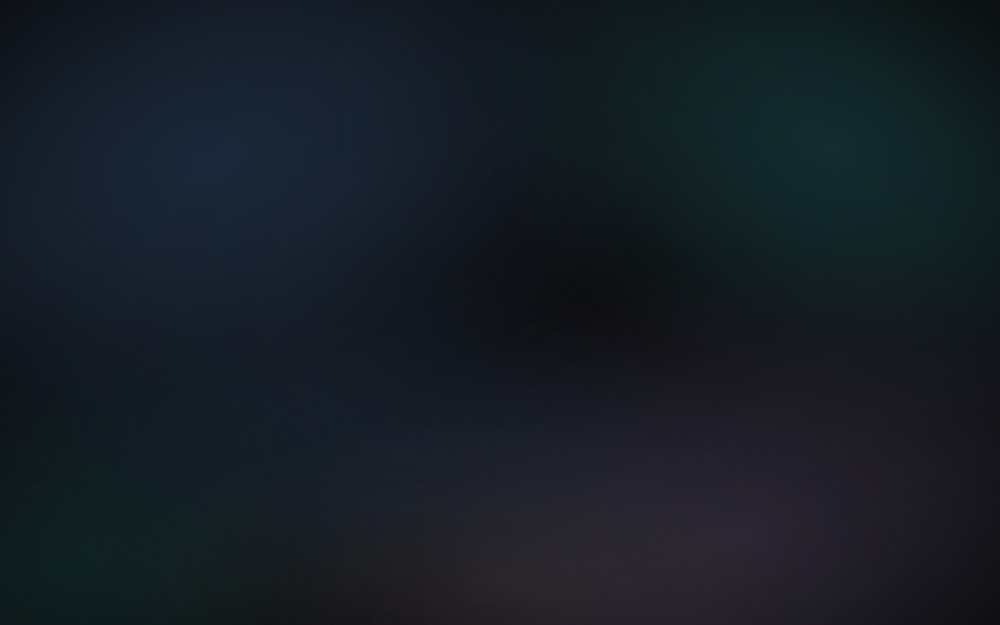

# Mesh Glow

A quiet colour field behind the conversation in the Claude desktop app. Large, soft fields of deep slate, sea teal and plum drift past each other very slowly over near-black, and a low warm light sits behind the prompt box. The field answers what Claude does, quietly: it lifts a little while Claude works, swells faintly at each tool call and brightens gently when a turn ends. It runs on the GPU, and the app's own colours are blue-slate grays taken from the same fields.



## Install

```bash
claude plugin marketplace add Samarth2001/claude-plugins
claude plugin install mesh-glow@samarth
```

Then run `/reload-plugins` in an open session, or start a new one.

## How it moves

| What happens | The backdrop |
| --- | --- |
| Claude is working | The colours lift a little and drift a touch faster |
| A tool call | A faint swell of light rolls out from the prompt |
| A tool error | The field warms toward rose for a moment |
| A turn ends | A gentle brightening that settles back |
| The prompt box grows | The warm light behind it rises with it |
| You send a message | A soft band of light lifts off the prompt |
| The pointer moves over it | A faint glow follows it |
| The hour (your computer's clock) | Cool by day, deeper at night, warmer at dawn and dusk |

Subagents' turns and tool calls leave it as it is. A turn you stop settles without the brightening.

## Use it

- `/mesh-glow` says whether it is on and drawn behind this window, and the glass.
- `/mesh-glow off` turns it off, here and in later sessions.
- `/mesh-glow on` brings it back.
- `/mesh-glow glass clear|soft|frosted` sets how much veil sits over the field behind the chat: none, a light one (the default), or the full frost. Kept across sessions.
- `/mesh-glow forget` deletes its settings and turns it off for this session. Run it before removing the plugin.

The [`themes`](../themes) picker (`/themes`) shows it beside the other themes, with a Glass option.

## Where it shows

- The Claude desktop app draws it live on Claude Code 2.1.326 or later.
- The mobile app, Reduce Motion and earlier builds show the still picture above, in the night colours from 19:00 to 06:00.
- The terminal and editors draw no backdrop.
- The shader runs at 30 fps and eases to a reduced sharpness on a weak GPU. `claude plugin validate` reports `sharpness 0.74 weak, 2.00 fast, at 30 fps`.

## Develop

From the repository root:

```bash
claude plugin validate --strict plugins/mesh-glow
claude plugin test plugins/mesh-glow
claude --plugin-dir plugins/mesh-glow     # try it, hot-reloads on save
```

- `hooks/shader.ts` is the field itself, on the GPU.
- `hooks/still.ts` is the still picture, `hooks/look.ts` the app's colours, and `hooks/register.tsx` wires the events, the command, the clock and the theme.

The preview above is the still picture by day. After changing it, draw it again:

```bash
node --experimental-strip-types scripts/assets/mesh-glow-preview.mts
```

See [CHANGELOG.md](CHANGELOG.md) for releases.
