# Pixel Room

A late-night pixel room behind the conversation in the Claude desktop app. Rain runs down a tall window, a desk lamp lights at dusk, and an orange cat sleeps on the windowsill until Claude starts working. Then it gets up and paces, sits to watch while tools run, jumps at an error, and stretches before curling up again when the turn ends clean. The room is drawn in one small palette of 17 colours, and the app's own colours, the working line, the footer and a small room card all come from it.



## Install

```bash
claude plugin marketplace add Samarth2001/claude-plugins
claude plugin install pixel-room@samarth
```

Then run `/reload-plugins` in an open session, or start a new one.

## The room

The room keeps to the left and right edges and the bottom of the window, so the middle, where the conversation sits, stays dark and calm.

- **The window**: a city behind the glass with a few lit windows, fast rain streaks outside and slower drops that gather and run down the pane. The window's light falls across the floorboards, and the rain's shadows slide through it.
- **The desk**: a small monitor with code scrolling a line at a time and a blinking cursor, a mug of tea with rising steam, a notebook and pencil, and a desk lamp.
- **The wall**: a shelf with a trailing plant and two books, a low bookcase with a candle under the window, and a round clock whose hands keep your local time.

| Time (your computer's clock) | The room |
| --- | --- |
| Day, 07:00 to 17:00 | Grey-blue daylight through the rain, the lamp off, the room a little cooler |
| Dusk, 17:00 to 19:00 | A rose and amber sky, the lamp lit |
| Night, 19:00 to 07:00 | A dark city with lit windows, the lamp casting a warm cone over the desk and a glow on the wall |

From dusk on, the app's colours turn warmer, with text the colour of old paper.

## The cat

| When | The cat |
| --- | --- |
| Claude is idle | Asleep on a cushion on the sill, breathing slowly, with a few drifting z's |
| Claude starts a turn | Gets up and paces the floor in front of the desk |
| The turn's first tool call | Sits up facing the desk and watches, tail flicking |
| The turn's first tool error | Jumps, ears back and tail on end, then settles back to watching |
| The turn ends clean | Stretches on the sill, then curls up to sleep |
| The turn ends with a failure, or you stop it | Curls straight up to sleep |

The cat moves at most four times a turn (its start, first tool call, first error and end), so the backdrop is not redrawn on every tool call. Subagents' turns and tool calls don't move it.

## The rest of the window

- **Working line**: while Claude works, the line that usually shows a made-up word says something about the room instead, such as "The cat is pacing", "Rain on the glass" or "Cat's watching the cursor". One phrase is chosen per turn. In the desktop app only the plain "Working" is replaced, so the names of steps stay. A message the app shows there, such as compacting, is never changed.
- **Footer**: one quiet label beside the app's own mode labels, such as `raining · lamp on`.
- **Room card**: a pane with a framed portrait of the cat in its current pose and a line on what it is doing ("asleep on the sill", "watching you work"). Below the portrait sit three small instruments for the session:
  - a row of five mugs that fill as turns finish
  - a cassette whose tape winds from one reel to the other as turns go by, its reels turning while Claude works
  - a plant that perks up after a passing test run and droops after a failing one

  In the desktop app the card opens by itself as a small widget showing just the portrait, once a session; it never opens itself in the terminal. Expanded or docked, it shows the whole card. In the terminal it is two lines of text.
- **Sounds**: a soft rising chime when a turn ends clean, and a soft low falling tone when its last tool call failed, its latest test run failed, or an API error ended it. Nothing plays when you stop a turn.

A test run is a Bash or PowerShell command such as `npm test`, `pytest`, `cargo test` or `go test`.

## Commands

| Command | Does |
| --- | --- |
| `/pixel-room` | Describes the room in a few lines: the weather, the lamp, the cat, the cups and the plant, whether sounds are on, and whether this window draws the room |
| `/pixel-room card` | Opens the room card |
| `/pixel-room card off` | Puts the card away and stops it opening by itself, here and in later sessions |
| `/pixel-room card on` | Brings the card back |
| `/pixel-room mute` | Turns the sounds off, here and later |
| `/pixel-room unmute` | Brings the sounds back |
| `/pixel-room off` | Turns off the room, its card, working line, footer label and sounds, here and in later sessions |
| `/pixel-room on` | Brings the room back |
| `/pixel-room forget` | Deletes its three settings and turns it off for this session. Run it before removing the plugin |

To try it beside the other themes and switch between them, install the [`themes`](../themes) picker and run `/themes`.

## Where it shows

- The backdrop, the colours and the widget need the Claude desktop app's Code tab; the backdrop and colours also show in the mobile app. Set the app's appearance to dark: the room and its colours are dark.
- The working line, the footer label and the room card also show in the terminal, where the card is plain text. The terminal draws no backdrop.
- Sounds play on macOS, where Claude Code plays clips with `afplay`. A Linux or Windows terminal has no player, so there they play nothing.
- It needs Claude Code v2.1.324 or later.

## What it stores and reads

- It stores three settings in the plugin's own store on your machine: whether the room is off, whether sounds are muted, and whether the card is put away. The cups, the tape and the plant's mood last for the session only.
- It reads whether each tool call errored and whether a Bash or PowerShell command looks like a test run. It reads the local time for the time of day and the clock.
- It never reads file contents, your prompts or Claude's replies, and it sends nothing anywhere.

## Known limits

- A session has one theme. Another theme mod replaces this one, and setting this one replaces the other.
- `/pixel-room off` clears whichever theme stands, not only this one. `/pixel-room forget` clears it only while the room is on.
- With reduced motion turned on in your system, the room and the card are still: no rain, no pacing, no breathing, and the clock shows the time the room was last drawn.
- On a square window the window and the desk move toward the middle. On a tall phone screen the window moves up and the bookcase, the floor light, the clock and the plant shelf are left out, so the window and the desk both fit.

## Develop

From the repository root:

```bash
claude plugin validate --strict plugins/pixel-room
claude plugin test plugins/pixel-room
claude --plugin-dir plugins/pixel-room     # try it, hot-reloads on save
```

- `hooks/palette.ts` holds the 17 colours.
- `hooks/pixels.ts` turns pixel maps into compact SVG paths and dither patterns.
- `hooks/sprites.ts` holds the cat's frames.
- `hooks/scene.ts` builds the room and `hooks/card.ts` the card.
- `hooks/room.ts` holds the state logic and the room's words.
- `hooks/look.ts` holds the app's colours.
- `hooks/register.tsx` wires the events, the command, the clock and the theme.
- `types/index.d.ts` declares the card's state.

The preview above is the scene exactly as the plugin draws it at night. The sounds in `sounds/` are synthesized. After changing the scene or the sounds, make them again:

```bash
node --experimental-strip-types scripts/assets/pixel-room-preview.mts
node --experimental-strip-types scripts/assets/pixel-room-sounds.mts
```

See [CHANGELOG.md](CHANGELOG.md) for releases.
