# Real Sky

A quiet sky almanac for the Claude desktop app. Behind the conversation, today's sky at your local hour: a graded sky with a fine grain, one hairline arc that the sun rides from 05:00 to 20:00 and the moon rides through the night in its real phase, a few sparse stars, and a low, misty horizon with a far-off skyline. The rest of the interface keeps the same log: muted colors taken from that sky, a spinner and a footer label that say what the sky is doing, and a small almanac card whose barometer follows the session.



## Install

```bash
claude plugin marketplace add Samarth2001/claude-plugins
claude plugin install real-sky@samarth
```

Then run `/reload-plugins` in an open session, or start a new one.

## The sky

| Local time | Sky | App colors |
| --- | --- | --- |
| 05:00 to 08:00, dawn | Blue hour warming through rose to a pale morning; the sun climbs the left foot of the arc | Dark slate, the accent the low sun's apricot |
| 08:00 to 17:00, day | Pale, slightly hazy blue; the sun crosses the top of the arc | Light grey paper, the accent a noon ochre |
| 17:00 to 20:00, dusk | Slate above, apricot at the horizon; the sun sets down the right foot | Dark warm grey, the accent the setting sun |
| 20:00 to 05:00, night | Ink blue with sparse stars; the moon rides the arc in today's phase, its dark side faintly lit | Ink blue, the accent moonlight |

- The arc carries a tick for each hour. The hours gone are a solid hairline, the hours to come dotted.
- The moon's phase is worked out from the date, so a crescent, a quarter or a full moon shows on the night it would.
- Two faint lines in the top-left corner note the part of the day, the time the sky was drawn, the weather and, after dark, the moon.
- The horizon is a few layers of low hills, paler with distance, with a slender skyline, a tower crane and a mast with a slow red light. Windows light up at dusk and through the night.
- The sky looks at your clock every five minutes. The sun and moon move in small steps, about 24 to each part of the day.
- The arc fits the window: wide, square and tall phone shapes each get their own, and the middle and foot of the window stay calm.

## The weather

| What happens in a turn | Sky |
| --- | --- |
| No errors, or a test run that passes | Clear, with thin high cirrus |
| A tool call that comes back as an error | Overcast: layered stratus, the light dimmed |
| Three errors or more, or a test run that fails | A storm: heavier bands, fine slanted rain, and now and then a cloud band brightens with lightning |

Worse weather shows as soon as it happens, mid-turn. The sky clears only when a turn ends with no errors, or with its last test run passing. Calls made by subagents count toward the turn that started them.

## The rest of the window

- **Spinner.** While Claude works, the spinner says what the sky is doing, sampled once a turn: "Reading the sky" by day, "Watching the light go" at dusk, "Counting stars" at night, "Riding out the storm" in a storm. A message the app sets, such as compacting, stands. In the desktop app the spinner keeps its own words when it says what a step is doing, and the sky's phrase takes the place of a bare "Working".
- **Footer.** One quiet label joins the mode labels at the right of the prompt footer, such as `dusk · clear`.
- **Almanac.** A small card: the sun's path in miniature with now marked, the hour, the four parts of the day on one line, the moon's phase, and the session barometer. Its needle falls with each error and rises with each clean turn; a set hand marks where the turn began, so a fall shows at a glance. A one-line forecast reads it: "Fair. 4 turns clear.", "Pressure falling, 2 errors this turn.", "Storm. A test run failed." In the desktop app the almanac opens as a widget, a compact glance of the arc, the hour and the barometer in a word, once each session. In the terminal it opens only when asked, as a few lines of text.

## Commands

| Command | Does |
| --- | --- |
| `/real-sky` | Reads the almanac: the sky and the hour, the moon, and the barometer |
| `/real-sky almanac` | Opens the almanac |
| `/real-sky almanac off` | Closes it, and stops it opening by itself in later sessions |
| `/real-sky almanac on` | Opens it, and lets it open as a widget at each start again |
| `/real-sky off` | Turns the sky, the spinner phrase and the footer label off here and in later sessions |
| `/real-sky on` | Brings them back |
| `/real-sky dawn`, `day`, `dusk` or `night` | Pins that part of the day, to preview it or keep it |
| `/real-sky auto` | Follows your clock again |
| `/real-sky forget` | Deletes its settings and turns it off for this session. Run it before removing the plugin |

To try it beside the other themes and switch between them, install the [`themes`](../themes) picker and run `/themes`.

## What it needs

- Claude Code v2.1.325 or later.
- The sky and the colors draw in the desktop app's Code tab and in the mobile app. The almanac card draws in the desktop app, VS Code and the mobile app, and as text in the terminal. The spinner phrase and the footer label show in the terminal and the desktop app.

## What it stores and reads

- It stores only its own settings: whether the sky is off, a pinned part of the day, and whether the almanac stays closed.
- It reads your machine's clock and time zone, whether each tool call came back as an error, and whether a Bash or PowerShell command looks like a test run.
- It never reads file contents, your prompts or Claude's replies, and it sends nothing anywhere.

## Known limits

- A session has one theme. Another theme mod replaces this one, and setting this one replaces the other.
- `/real-sky off` clears whichever theme stands, not only this one. `/real-sky forget` clears it only while the sky is on.
- The day look is light and the others dark, whatever the app's own appearance is set to.
- The moon's phase is a mean-month estimate, within about a day of the true one. Its lit side is drawn as seen from the northern hemisphere.
- The time in the sky's corner is the time it was last drawn, which moves in the sun's small steps.
- A call you deny counts as an error where the app reports it as one.
- With reduced motion turned on in your system, the drifting cirrus, rain, twinkling stars and the mast's light stand still and there is no lightning.

## Develop

From the repository root:

```bash
claude plugin validate plugins/real-sky
claude plugin test plugins/real-sky
claude --plugin-dir plugins/real-sky     # try it, hot-reloads on save
```

`hooks/phase.ts` holds the arithmetic: the time of day, the arc, the moon's phase, the weather and the barometer. `hooks/scene.ts` builds the sky as one SVG, `hooks/card.ts` the almanac card and glance, `hooks/voice.ts` the words, `hooks/look.ts` the app's colors and glass, and `hooks/register.tsx` the events, clock, command, theme and drawings. `types/index.d.ts` declares what the drawings read from `$.state`. `/real-sky dawn` and the other words make it quick to see each look.

The preview above is the scene exactly as the plugin draws it, at 18:12 on a clear dusk. After changing the scene, draw it again:

```bash
node --experimental-strip-types scripts/assets/real-sky-preview.mts
```

See [CHANGELOG.md](CHANGELOG.md) for releases.
